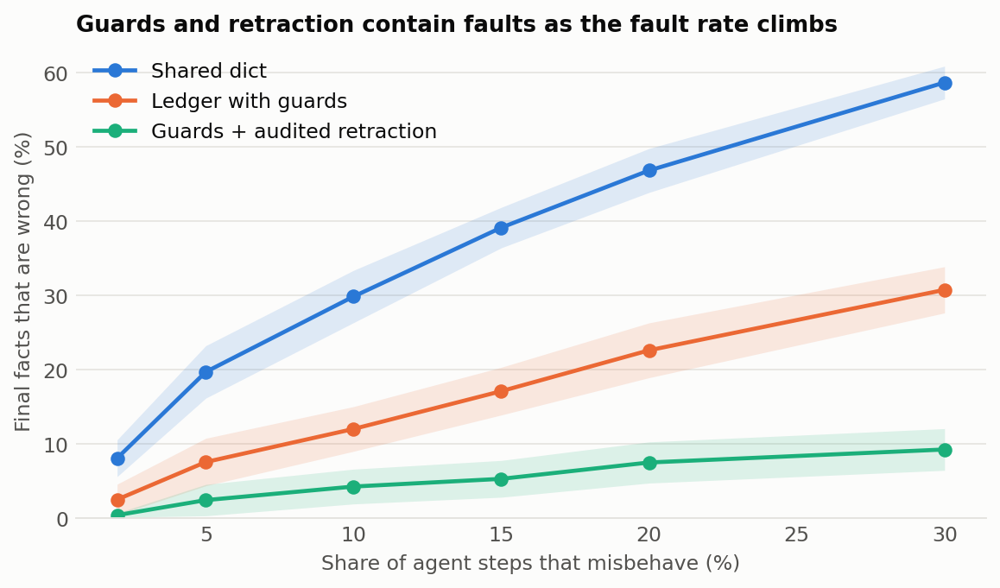
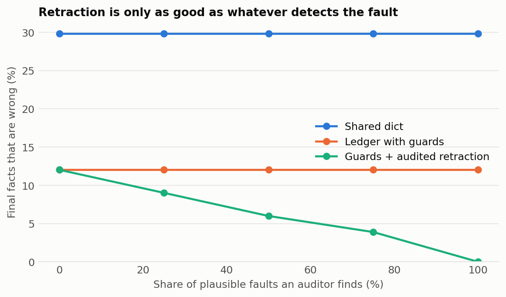

# agentledger

Transactional shared memory for multi agent systems. When several agents share a scratchpad, one wrong write quietly becomes every later agent's input. agentledger treats that memory like a database: agents propose, guards decide, commits are atomic, and a bad fact can be retracted along with everything built on it.

```python
from agentledger import ConflictGuard, Ledger, RangeGuard

ledger = Ledger([RangeGuard("score", 0, 100), ConflictGuard()], path="memory.db")

with ledger.begin("researcher") as tx:
    tx.write("revenue", 120, confidence=0.9, evidence=["10-K page 4"])
bad = max(ledger.commits)

with ledger.begin("analyst") as tx:
    tx.write("forecast", tx.read("revenue") * 1.1)   # the read is recorded

ledger.retract(bad)              # undoes revenue AND the forecast derived from it
ledger.get("forecast")           # None
```

## What it guarantees

* **Atomic commits.** A transaction applies fully or not at all, and an exception discards it.
* **Guards.** Types, ranges, required evidence, and blocking an unsure agent from overwriting a confident fact. Write your own by subclassing `Guard`.
* **No lost updates.** Reads are versioned, so a commit fails with `Conflict` if something it read has changed. A test runs 8 threads doing 800 increments with none lost.
* **Cascading retraction.** Each commit records what it read, so retracting one also undoes commits that used its value, and only those. A later commit that read a corrected value is left alone.
* **Checkpoints and rollback**, which only store a position in the log.
* **Audit log and durability.** Full history stays available, and an optional SQLite file survives restarts.

## Does it help?

[`benchmarks/`](benchmarks/) simulates 200 step pipelines where each step derives a fact from earlier ones, over 40 seeds per setting. Steps misbehave in three ways: an impossible value, an unsure overwrite of a good fact, or a plausible wrong value that no guard can catch.

<picture>
<source media="(prefers-color-scheme: dark)" srcset="results/charts/fault-rate-dark.png" />

</picture>

At a 10% fault rate, the share of final facts that are wrong falls from **29.8%** with a shared dict to **12.0%** with guards and **4.3%** with guards and retraction, assuming an auditor finds 70% of plausible faults.

<picture>
<source media="(prefers-color-scheme: dark)" srcset="results/charts/audit-recall-dark.png" />

</picture>

**The second chart is the honest limit:** a ledger can only undo what something detects. With no auditor, retraction adds nothing beyond guards.

Recovery is also targeted. Undoing audited faults took about 15 commits per run with cascading retraction, against about 156 for rolling back to a checkpoint before the first fault.

**These numbers come from scripted agents and no LLM.** The fault rates and auditor recall are assumptions, so they show how the memory layer behaves and not how much a real system would improve. Recovery also assumes a rerun step succeeds.

### Speed

In memory on an Apple M5, one thread: about 413K commits per second with a 50,000 commit log, and 1.1 ms to retract a commit with 50 dependents. The bottleneck in a real agent will be the LLM. SQLite persistence is slower and isn't included.

## Trying risky plans

```python
branch = ledger.fork()
# ...let an agent work in the branch...
ledger.merge(branch)    # guards still apply
```

## Limitations

* It's a single process library with one lock, not a distributed store.
* Guards are only as good as their rules. `ConflictGuard` compares values for equality and trusts self reported confidence, so it can't detect that two differently worded facts contradict.
* Taint tracking only sees reads made through the transaction. An agent that copies a value out of band isn't tracked.
* Forks are only in memory, and `merge` replays writes without conflict resolution beyond the guards.

## Run it

```
pip install -e ".[dev]"
pytest
python -m benchmarks.fault_injection
python -m benchmarks.sweep
```

No dependencies beyond the Python standard library.
